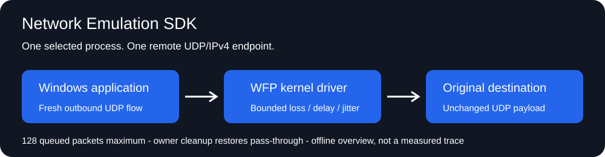

# Network Emulation SDK - Microsoft-signed Windows Kernel UDP Network Emulator

**Reproduce outbound UDP loss and delay for one selected Windows process and endpoint.**

A private KMDF/WFP callout operates in the Windows datagram path. The native C++ app and compact SDK configure deterministic packet loss, a bounded delay and cyclic jitter without a proxy or changes to the application's payload.



**Microsoft-signed evaluation for Windows x64.** The complete 0.1.1 release contains the app, CLI, SDK, example, installer sources and self-contained UI/console installers with the signed 0.1.0.0 driver. Actual signed installation, UDP tests and full removal passed on Windows 10 x64 normally and under targeted Driver Verifier, with test-signing disabled. The labelled offline preview remains available without opening a driver.

## Scope

| Setting | Meaning |
| --- | --- |
| Process ID + remote IPv4/UDP port | One explicitly selected process and destination; no global traffic policy. |
| Drop every N | Drop each Nth matching classifier indication after Start/policy replacement; zero disables loss. Supported traffic has one UDP datagram per indication. |
| Delay | 0..1000 ms before outbound reinjection; actual Windows scheduling adds variability. |
| Jitter | Deterministic cyclic variation within +/- the selected amount, no larger than the base delay; the effective target can reach 2000 ms. |
| Retained packets | At most 128 retained packets, including allocation reservations and in-flight injections; overflow passes through and increments a counter. |
| Flow tracking | At most 64 associated UDP flows. Unsupported/overflow traffic passes through. |

Only ordinary outbound UDP/IPv4 with one network buffer is supported. TCP, IPv6, inbound traffic, raw sockets, multiple-buffer batches and unsupported ancillary metadata pass unchanged. The destination validator excludes multicast and reserved high address ranges; directed broadcast is not qualified. No content inspection, replay, corruption, bandwidth limiter, network tunnelling or arbitrary packet generation is provided.

**Start a fresh UDP socket after first enabling a policy or selecting a different process/endpoint.** Existing flows cannot be associated retroactively. Editing loss/delay for the currently associated scope applies to subsequent packets of that flow. A process reference prevents PID reuse from silently selecting a different process; target exit disables the policy.

Closing the owner or allowing its permission to expire restores pass-through. Already queued packets are released immediately; a socket that closes before reinjection can cause a reported injection error. FIFO deadlines prevent deliberate reordering inside the delay queue, but overflow pass-through can overtake delayed packets. No timing or delivery guarantee is made under CPU pressure.

## Run

1. Download and extract the complete [release ZIP](https://github.com/titanfyre/Network-Emulation-SDK/releases/tag/v0.1.1).
2. Open `NetworkEmulation.exe --preview` for the offline editor, or request a Network Emulation SDK access key from **`titancsa` on Discord** for live operation. The signed bundle does not require test-signing.
3. With a signed bundle, run `NetworkEmulationSetup.exe`, choose **Install / reinstall**, and restart only if requested. Console deployment uses `/install` and `/uninstall`; exit code `3010` requests a manual restart. Setup verifies exact product identity and Microsoft-root catalog plus INF/SYS membership; it never restarts automatically.
4. Open the application as administrator, enter your product access key, select an authorized target PID and numeric IPv4/UDP destination, then choose **Authorize & start**. Create the application's new UDP socket afterwards.
5. **Stop** or close the app to release the policy. Test only software and traffic you own or are authorized to administer.

`NetworkEmulationCLI.exe --preview` is offline. `status` reads the real driver state; interactive use asks for the access key and explicit policy. Only one administrator owns the control endpoint at a time. The UI refreshes counters at 200 ms; it does not set packet scheduling cadence. Authorization runs on a worker thread.

## Minimal C++ integration

Keep the entire `SDK/` directory and compile `Emulator.cpp`; link `fwpuclnt.lib`, `ws2_32.lib`, `winhttp.lib`, `crypt32.lib` and `rpcrt4.lib`.

```cpp
#include "SDK/Emulator.h"

NetworkEmulator emulator;
auto error = emulator.Authorize(accessKey); // English message, empty on success.
if (!error.empty()) return;

NE_POLICY policy{NE_VERSION, sizeof(NE_POLICY)};
policy.process_id = GetCurrentProcessId();
policy.remote_ipv4 = 0x7f000001; // Host-order 127.0.0.1.
policy.remote_port = 45000;
policy.drop_every = 3;
policy.delay_ms = 40;
error = emulator.Start(policy);
// Open a NEW UDP socket in this process after Start() succeeds.
// Scope exit restores pass-through and removes this session's WFP filters.
```

`Start(policy)` returns an English error string. `Authorize(key)` obtains a signed permission for the current handle. `Status()` returns real counters or throws an English error. `Stop()` is idempotent. Serialize calls on a single SDK object; stop all callers before destruction. `NativeHandle()` exists for advanced protocol diagnostics, not ordinary integration.

`matched`, `dropped`, `delayed` and `queue_overflow` count this classifier's supported indications cumulatively for the driver lifetime. The loss/jitter sequence resets whenever a policy is started/replaced. `injected` counts reinjection calls accepted by WFP, not confirmed network delivery. `failed` counts immediate reinjection refusals. A full queue increments `bypassed` and `queue_overflow`; it does not wait in a classification callback. No data is exported unless you explicitly add export code to your application.

## Access and commercial integration

Add **`titancsa` on Discord** for evaluation access, an OEM integration pilot, redistribution rights, branded deployment and Windows maintenance. Specify your UDP workload, target Windows builds and acceptance criteria. Free alternatives such as [clumsy](https://jagt.github.io/clumsy/) exist; this component offers a bounded native integration API and scoped qualification rather than claiming a unique emulator or guaranteed revenue.

Product-specific keys request ECDSA P-256 per-handle permissions from the shared administration. Permissions last at most one hour and can be explicitly renewed while the key is enabled. Revocation prevents future grants; it does not instantly cancel accepted permissions. There is no TPM, machine fingerprint, automatic payment collection or per-machine seat enforcement. No cryptography or HTTPS runs for each datagram.

Public app/SDK/example/installer source is MIT licensed. The private driver binary has separate evaluation and OEM terms. Microsoft signing alone is not WHQL certification or evidence of universal reliability. See [validation](docs/VALIDATION.md).

## Build

Use Visual Studio 2022 Desktop C++, CMake and Windows SDK on x64:

```powershell
.\Build.ps1
.\Build.ps1 -Asan
# Embed an independently supplied opaque signed package when rebuilding setup.
.\Build.ps1 -DriverPackageDirectory C:\Signed\TitanNetworkEmulation
```

Outputs are under `obj/Build/bin/Release`. Public builds do not need a WDK or private kernel source. They never install a driver or change a network policy. Unsigned/test-signed packages are refused by setup.

Use only for lawful diagnostics and integration on authorized systems. You are responsible for your deployment and use; the software is supplied without warranty, subject to applicable licenses and mandatory statutory rights. No unlawful or unauthorized use is endorsed.
